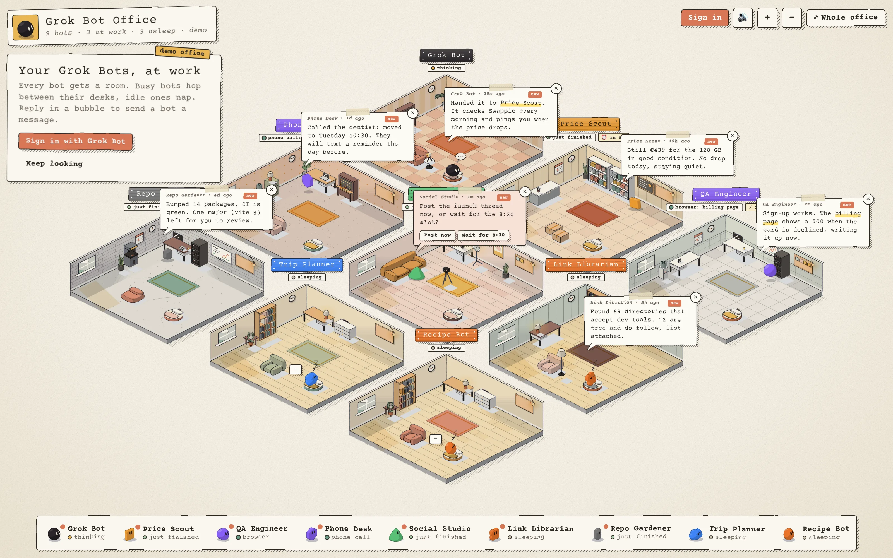

# grokhouse

Watch your **Grok Bots** work in a cozy isometric office, and talk to them. Live at [grokhouse.dev](https://grokhouse.dev).



Every bot gets its own room. Busy bots hop between their desks, idle ones potter about, and the rest nap in bed. A bot's last message pops up as a comic speech bubble: close it with the ✕, or type in it to send the bot a prompt.

Signed out, the page shows a demo office. Open [grokhouse.dev/?demo](https://grokhouse.dev/?demo) to see it while signed in.

## Run it locally

```bash
pnpm install
pnpm dev            # http://localhost:5173, the Worker runs inside Vite
pnpm run build      # tsc for page and Worker, then vite build
npx vitest run      # state reducer tests
```

No env vars or secrets are needed. Sign-in tokens live in an HttpOnly cookie on your own browser.

## What it shows

| in the office | from the Grok Bot API |
| --- | --- |
| bot asleep in bed, Zzz | not running, no activity for 90 s |
| bot hopping between work spots | `live.running` with a tool `activity` |
| thought bubble, pacing | running, thinking |
| bot waving with a "?" | `live.awaiting`: it waits for you |
| speech bubble, answer buttons | latest transcript message, pending choice or approval card |
| wall clock hands, ⏰ chip | next automation run (`nextRunAt`) |
| calendar and alarm clock | the bot has automations |
| sticky notes on the corkboard | the bot's todo list |
| room theme | words in its name, description, schedules and the apps it used |

**Room themes**: lobby (the primary bot), shop (prices, deals), lab (QA, tests), calls (phone, SMS), studio (X, social), library (SEO, research), dev (code, repos) and a cozy den for the rest.

Soft **sound effects** play when you send a message, when a bot answers, starts working or waits for you, and keys clack quietly while bots work. The 🔊 button mutes them.

## Architecture

```
browser (src/)                      Cloudflare Worker (worker/)       Cursor backend
┌────────────────────────────┐     ┌─────────────────────────┐      ┌──────────────────┐
│ main.ts  snapshot, stream  │────▶│ index.ts  router        │─────▶│ api2.cursor.sh   │
│ state.ts  pure reducer     │     │  tokens in HttpOnly     │      │  GrokBotService  │
│ layout.ts  bot ▶ room plan │     │  cookie, auto refresh   │      │  /auth/poll      │
│ scene/viewer.ts  canvas    │     │ office.ts  aggregation  │      │  /oauth/token    │
│ scene/actors.ts  moods     │     │ grok.ts  API client     │      └──────────────────┘
│ engine/*  isometric print  │     │ protocol.ts  /api types │
│ ui/hud.ts  signs, bubbles  │     └─────────────────────────┘
└────────────────────────────┘
```

The page loads `/api/office` once, then keeps one **live stream** open (`/api/watch`, the app's own `WatchGrokBotTranscripts`). It carries new messages, live state, read state from every client, and roster changes, so new bots appear without a reload.

Every input becomes an event folded by the pure reducer in `src/state.ts`. What shows on screen is derived from that state, so a slow snapshot can never undo newer stream data.

A bot's bubble shows while its last message is **unread** for your account. Closing it marks the bot read, so it is read in the Grok Bot app too, and reading it in the app hides it here.

The **isometric engine** (`src/engine/`) prints rooms and furniture once into cached canvases. Furniture is plain data in `public/kinds.json`. The mascots are small 3D bodies ray cast into cached sprites, with outlines taken from the Grok Bot app.

## Sign-in

Grok Bot has **no public API**. The Worker uses Cursor's browser sign-in (the same one the Cursor CLI uses), then calls the private `aiserver.v1.GrokBotService` that the Grok Bot desktop app uses. Choose **Continue with Grok** on Cursor's page if your bots live on your Grok account.

Cursor can change or block this at any time. The private API is documented in [docs/grok-bot-api.md](docs/grok-bot-api.md).

## Deploy your own

```bash
pnpm run deploy     # build, then wrangler deploy
```

Edit `routes` in `wrangler.jsonc` to use your own domain, or remove it to deploy on `*.workers.dev`.

## Credits

Sound effects are CC0, from Freesound via Openverse. See [public/sounds/CREDITS.md](public/sounds/CREDITS.md).

grokhouse is a fan project. It is not affiliated with xAI, Grok or Cursor.

## License

[MIT](LICENSE)
